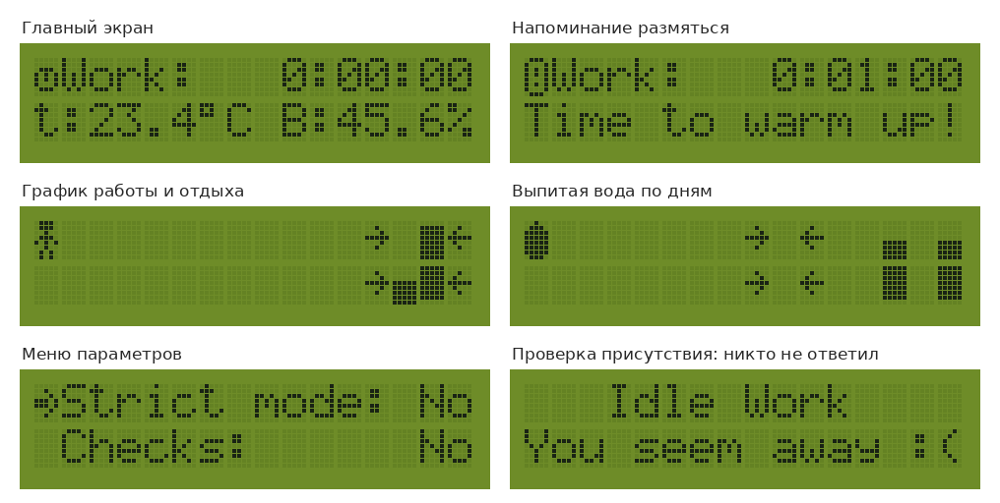
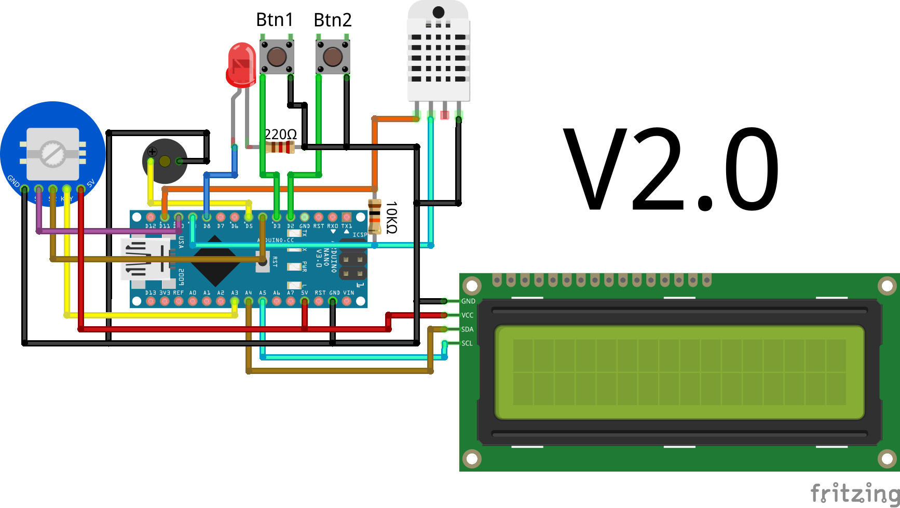
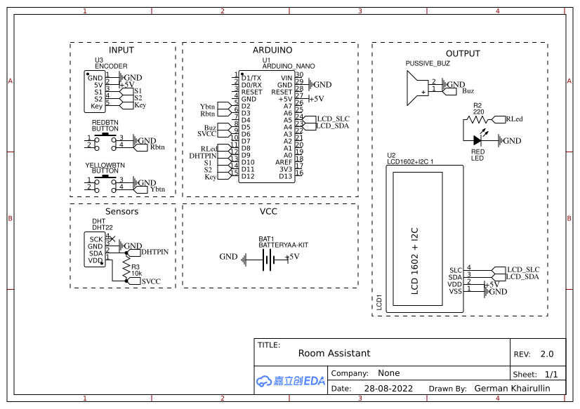

# Room Assistant


Комнатный помощник на Arduino Nano: напоминает вовремя размяться и отдохнуть, следит за температурой и влажностью в комнате, считает выпитую воду и рисует графики активности прямо на LCD-экране.

## О проекте

Room Assistant — один из моих первых pet-проектов. Устройство работает в трёх режимах — **Work** (работа), **Relax** (прокрастинация) и **Offline** (отдых вдали от компьютера) — и по таймеру напоминает, что пора сменить занятие. Статистика по каждому режиму сохраняется в EEPROM и отображается в виде столбчатых графиков.

### Зачем это нужно

Сидячий образ жизни — одна из главных проблем здоровья современного человека. По [данным РБК Стиль](https://style.rbc.ru/health/5dac0dfa9a79474bc746668c), один из способов с ней бороться — регулярная разминка. Устройство напоминает, что пора размяться, и сообщает, если вы слишком долго отдыхаете.

## Возможности

- Три режима работы с независимыми таймерами: Work, Relax, Offline
- Настройка таймеров и параметров прямо на устройстве, без перепрошивки
- Два быстрых профиля (красная и жёлтая кнопки) и профиль по умолчанию
- Температура и влажность воздуха на главном экране (DHT22)
- Графики статистики: время работы/отдыха, пропущенные уведомления, выпитая вода
- Случайные «проверки присутствия» в режиме Work: если не нажать кнопку, устройство решит, что вы ушли, и переключится в Offline
- Счётчик воды (цель — 10 стаканов) и напоминание выпить воды
- Три уровня энергосбережения, питание от батареек
- Базовые параметры можно поменять в начале скетча, не разбираясь в остальном коде

## Внешний вид

### Экраны



*Снимки получены в симуляторе: прошивка запускалась на эмуляторе ATmega328P с эмуляцией дисплея LCD1602.*

### Прототип

<!-- Вставьте фото прототипа: положите файл в source/photos/ и раскомментируйте строку ниже -->
<!--  -->

### 3D-модель корпуса

<!--  -->

### Корпус

<!--  -->

Фото готового устройства в корпусе, к сожалению, не сохранилось.

## Что понадобится

### Компоненты

| Компонент | Примечание |
|---|---|
| Arduino Nano (ATmega328P) | |
| Дисплей LCD 1602 с I2C-адаптером | Адрес по умолчанию `0x27` |
| Датчик DHT22 | Плюс подтягивающий резистор 10 кОм между линией данных и питанием |
| Энкодер с кнопкой | Модуль с выводами GND, +5V, S1, S2, KEY |
| 2 тактовые кнопки | Красная и жёлтая |
| Светодиод + резистор 220 Ом | |
| Пассивный зуммер | |
| Питание 5 В | USB или батарейный отсек |

### Подключение

Кнопки и энкодер используют внутреннюю подтяжку (`INPUT_PULLUP`), поэтому кнопки подключаются между пином и GND.

| Назначение | Пин | Константа в коде |
|---|---|---|
| Зуммер (сигнал) | D5 | `BUZ` |
| Светодиод | D8 | `RED` |
| Красная кнопка | D3 | `REDBUT` |
| Жёлтая кнопка | D2 | `YELLOWBUT` |
| Энкодер, вывод S1 | D10 | `S1` |
| Энкодер, вывод S2 | D4 | `S2` |
| Энкодер, кнопка KEY | A3 | `KEY` |
| DHT22, линия данных | D9 | `DHTPIN` |
| DHT22, питание | D11 | `SEN_VCC` |
| LCD, SDA | A4 | — |
| LCD, SCL | A5 | — |

Датчик DHT22 питается от пина D11: так его можно отключать в режиме энергосбережения. Пин D12 (`BUZ_VCC`) предусмотрен в коде для питания зуммера, но в схеме не используется.

### Схемы




Если схемы и таблица пинов расходятся, ориентируйтесь на таблицу: она соответствует коду.

## Установка

### 1. Программы и библиотеки

Понадобится [Arduino IDE](https://www.arduino.cc/en/software) (1.8.x или 2.x). Установите библиотеки через **Скетч → Подключить библиотеку → Управлять библиотеками**:

| Библиотека | Автор | Зачем |
|---|---|---|
| [LiquidCrystal_I2C](https://github.com/johnrickman/LiquidCrystal_I2C) | John Rickman / Frank de Brabander | Вывод на LCD |
| [EncButton](https://github.com/GyverLibs/EncButton) **версии 2.0** | AlexGyver | Энкодер и кнопки (класс `EncButton2`) |
| [DHT sensor library](https://github.com/adafruit/DHT-sensor-library) | Adafruit | Датчик DHT22 |
| [Adafruit Unified Sensor](https://github.com/adafruit/Adafruit_Sensor) | Adafruit | Зависимость DHT sensor library |
| [GyverPower](https://github.com/GyverLibs/GyverPower) | AlexGyver | Энергосбережение |

> **Важно:** нужна библиотека EncButton именно **версии 2.0**: только в ней есть класс `EncButton2`. В менеджере библиотек найдите EncButton и выберите версию 2.0 в выпадающем списке. С версией 3 и выше скетч не соберётся.

Библиотеки `Wire` и `EEPROM` входят в состав Arduino IDE.

### 2. Скачивание проекта

Нажмите **Code → Download ZIP** на странице репозитория и распакуйте архив либо клонируйте репозиторий через `git`.

### 3. Прошивка

1. Соберите устройство по таблице пинов и схемам.
2. Откройте файл `RoomAssistant/RoomAssistant.ino` в Arduino IDE (остальные файлы скетча подтянутся автоматически).
3. Выберите плату: **Инструменты → Плата → Arduino Nano**.
4. Выберите процессор: **ATmega328P**. Если загрузка не проходит (частая история с китайскими клонами), выберите **ATmega328P (Old Bootloader)**.
5. Выберите порт и нажмите **Загрузить**.

Если экран включается, но текст не виден, возможно, у вашего I2C-адаптера другой адрес (часто `0x3F`). Измените его в строке `LiquidCrystal_I2C lcd(0x27, 16, 2);` в файле `RoomAssistant.ino`. Адрес можно узнать скетчем I2C Scanner.

## Настройка

Параметры в файле `RoomAssistant/Config.h` можно менять без знания остального кода. Там же переназначаются пины. Все значения времени указываются в **минутах**.

| Константа | По умолчанию | Описание |
|---|---|---|
| `ReminderOnline` | 60 | Время работы в профиле «по умолчанию» |
| `RepeatedReminderOnline` | 20 | Через сколько повторить напоминание, если вы пропустили его (Work, профиль по умолчанию) |
| `ReminderRelax` | 20 | Время прокрастинации в профиле «по умолчанию» |
| `RepeatedReminderRelax` | 10 | Повторное напоминание (Relax, профиль по умолчанию) |
| `ReminderOff` | 30 | Время отдыха в профиле «по умолчанию» |
| `RepeatedReminderOff` | 10 | Повторное напоминание (Offline, профиль по умолчанию) |
| `RandomCheckupMin`, `RandomCheckupMax` | 10, 50 | Диапазон, в котором случайно выбирается момент проверки присутствия (режим Work, пункт Checks) |
| `randomAlertTime` | 20 | Максимальная случайная добавка к таймеру, чтобы напоминания были менее предсказуемыми (отключается режимом Strict) |
| `reminderDrink` | 60 | Через сколько минут после последнего стакана напомнить выпить воды |
| `OnlineTime1`, `RelaxTime1`, `OffTime1` | 90, 30, 20 | Быстрый профиль 1 (красная кнопка): Work / Relax / Offline |
| `OnlineTime2`, `RelaxTime2`, `OffTime2` | 30, 15, 10 | Быстрый профиль 2 (жёлтая кнопка): Work / Relax / Offline |
| `SIMULATION` | 0 | `1` — сборка для онлайн-симулятора (без сна и сторожевого таймера), `0` — для настоящей платы |
| `BTNSOUNDS` | 1 | `1` — звуки нажатий разрешены (если включены в меню), `0` — всегда выключены |

## Использование

### Краткое руководство

**Первый запуск.** После первой прошивки все параметры выключены, в том числе звук. Пройдите ручную настройку до меню параметров (см. ниже), включите звук (**Sounds**) и энергосбережение **Min**, затем выберите **SaveSettings**. Настройки сохранятся и после выключения.

**Начало дня.** Включите устройство. Когда после заставки появится надпись «by Fompi», удерживайте около секунды:

- красную кнопку — профиль 1 (работа 90 мин, отдых 30, офлайн 20);
- жёлтую — профиль 2 (30 / 15 / 10);
- энкодер — профиль по умолчанию (60 / 20 / 30);
- ничего не нажимайте — откроется ручная настройка времени.

Устройство начинает работу в режиме Work.

**В течение дня:**

| Что сделать | Что произойдёт |
|---|---|
| Нажать красную кнопку | Ушли от компьютера (Offline). Из Offline — снова Work |
| Нажать жёлтую кнопку | Отдыхаете за компьютером (Relax), в том числе из Offline. Из Relax — снова Work |
| Удерживать обе кнопки ~1,5 с | Выход в меню настройки времени |
| Повернуть энкодер | Листать экраны: главный → вода → графики |
| Нажать энкодер на экране воды | Плюс один стакан. Удержание — сброс счётчика |
| Нажать энкодер на графике | Подробные цифры за выбранный день |
| Повернуть энкодер с нажатой кнопкой на графике | Выбрать день |

Когда время режима вышло, устройство пищит, загорается светодиод и появляется подсказка. Нажмите кнопку того режима, в который переходите. Если не нажать, светодиод будет мигать, напоминание повторится, а лишнее время попадёт в статистику «сверх нормы».

Если включены проверки присутствия (**Checks**), в режиме Work устройство иногда пищит и мигает без подсказки. Нажмите любую кнопку, иначе примерно через 15 секунд оно решит, что вы ушли, и перейдёт в Offline.

**Конец дня — сохраните данные.** Статистика текущего дня хранится в оперативной памяти и при выключении пропадает. Перед выключением перейдите на любой экран с графиком (два щелчка энкодера от главного) и удерживайте энкодер, пока не появится «Data saved!». После этого устройство можно выключать. Сохраняйте один раз в день, прямо перед выключением: если после сохранения продолжить работу, эти минуты попадут и в следующий сохранённый день.

**Энергосбережение.** Для повседневного использования выберите **Min**: экран всегда включён, а неиспользуемые модули микроконтроллера отключены. **Eco** гасит экран через 2 минуты без действий, поэтому подходит только при питании от батареек.

### Запуск

После включения проигрывается заставка (около 6 секунд), затем на 2 секунды открывается окно быстрого выбора профиля. Если профиль не выбран, через 3 секунды открывается ручная настройка — примерно через 11 секунд после включения. **Удерживайте** нужную кнопку, пока не появится сообщение:

| Что удерживать | Результат |
|---|---|
| Красная кнопка | Профиль 1 (по умолчанию 90 / 30 / 20 минут) |
| Жёлтая кнопка | Профиль 2 (по умолчанию 30 / 15 / 10 минут) |
| Энкодер | Профиль по умолчанию (60 / 20 / 30 минут) |
| Красная + жёлтая | Уведомления отключены (таймеры по 10 часов) |

Если ничего не удерживать, откроется ручная настройка:

1. Вращайте энкодер, чтобы задать время работы: оборот меняет значение на 1 минуту, оборот с нажатой кнопкой — на 10 минут. Максимум — 9 ч 59 мин. Если уйти ниже нуля, выберется профиль по умолчанию.
2. **Удержите энкодер**, чтобы перейти к следующему шагу: время Relax → время Offline → меню настроек.
3. Удержание энкодера в меню настроек запускает устройство в режиме Work.

### Управление в рабочих режимах

| Кнопка | Из Work | Из Relax | Из Offline |
|---|---|---|---|
| Красная | → Offline | → Offline | → Work |
| Жёлтая | → Relax | → Work | → Relax |

Удержание обеих кнопок возвращает в меню настройки времени.

Когда время режима истекает, устройство подаёт сигнал (светодиод и зуммер) и показывает подсказку. Если уведомление пропущено, светодиод продолжает мигать, а напоминание повторится через время, заданное для повторных уведомлений.

Вращение энкодера переключает экраны:

| Экран | Что показывает |
|---|---|
| 1 | Таймер текущего режима, температура и влажность |
| 2 | Таймер и счётчик воды (клик — плюс стакан, удержание — сброс). Отмеченный стакан откладывает напоминание о воде |
| 3 | График времени онлайн и офлайн за последние дни |
| 4 | График времени работы и отдыха |
| 5 | График пропущенных уведомлений |
| 6 | Время сверх нормы: сколько минут прошло после пропущенного уведомления (по режимам Work / Relax / Offline) |
| 7 | График выпитой воды по дням |

На экранах статистики **удержание энкодера** сохраняет текущие данные в EEPROM, и история сдвигается на один «день». История хранит 4 последних сохранённых дня плюс текущий (для воды — 7 дней плюс текущий). Вращение с нажатой кнопкой выбирает день, клик открывает подробные значения. В подробном виде вращение переключает строку, а поворот с нажатой кнопкой правит значение (время — по 10 минут, вода — по одному стакану).

### Меню настроек

Вращайте энкодер, чтобы выбрать пункт, и кликайте, чтобы изменить значение.

| Пункт | Значения | Описание |
|---|---|---|
| Strict mode | Yes / No | Yes — таймеры срабатывают точно, без случайной добавки |
| Checks | Yes / No | Случайные проверки присутствия в режиме Work |
| EnergySave | Off / Min / Eco | Уровень энергосбережения (см. ниже) |
| Sounds | No / Alarm / All | Без звука / только сигналы / сигналы и звуки нажатий |
| SaveSettings | — | Сохранить настройки в EEPROM |
| ResetSettings | — | Сбросить настройки и статистику (применяется после перезагрузки) |

> После первой прошивки все переключатели выключены, в том числе звук. Включите звук в пункте Sounds.

**Уровни энергосбережения:**

- **Off** — энергосбережение выключено
- **Min** — отключаются неиспользуемые периферийные модули (SPI, UART)
- **Eco** — дополнительно: через минуту без действий контроллер «засыпает» между обновлениями, через две минуты гаснут экран и подсветка, отключается питание датчика. Будят прибор нажатие красной или жёлтой кнопки и поворот энкодера. Если экран был погашен, это нажатие или поворот только включает экран и ничего не переключает

### Проверки присутствия

Если включён пункт Checks, в режиме Work устройство через случайные промежутки времени подаёт сигнал и ждёт нажатия любой из двух кнопок. Если за ~15 секунд вы не отреагировали, устройство решает, что вы отошли, и переключается в режим Offline.

## Структура проекта

```
Room-Assistant/
├── RoomAssistant/            # скетч Arduino
│   ├── RoomAssistant.ino     # главный файл скетча: глобальные объекты и переменные
│   ├── Config.h              # настройки таймеров и профилей, пины
│   ├── Types.h               # константы, структуры, значки для LCD
│   ├── RoomAssistant.h       # общие объявления для всех модулей
│   ├── Setup.cpp             # setup(), loop(), заставка, быстрые профили
│   ├── Input.cpp             # энкодер: опрос в прерывании, счётчики поворотов
│   ├── Menu.cpp              # меню настройки времени и параметров
│   ├── ModeCommon.cpp        # общая логика режимов: таймеры, напоминания, экраны
│   ├── ModeNormal.cpp        # режимы без глубокого энергосбережения
│   ├── ModeEco.cpp           # режимы с энергосбережением (Eco)
│   ├── Screens.cpp           # главные экраны режимов
│   ├── Graphs.cpp            # графики статистики
│   └── Storage.cpp           # сохранение в EEPROM
├── source/                   # схемы подключения, снимки экранов, фото
├── LICENSE
└── README.md
```

Логика вынесена в `.cpp`-файлы, а `.ino` содержит только глобальные объекты. Arduino IDE автоматически генерирует объявления функций только для `.ino`-файлов и иногда вставляет их раньше нужных типов; с `.cpp` такой проблемы нет.

## Статус проекта

Проект **завершён**. Я закончил работу над Room Assistant и не планирую его развивать или поддерживать. Репозиторий остаётся доступным как есть: вы можете использовать код и схемы, а также форкнуть проект и доработать его под свои задачи.

## Лицензия

Проект распространяется по лицензии [MIT](LICENSE).

## Автор

Fompi
